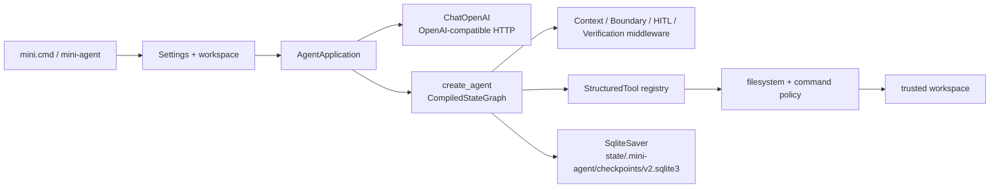

# mini-agent-lab

一个面向受信任本地项目的受控 coding agent。v2 使用 LangChain 的
`create_agent` 组装标准工具循环，使用 LangGraph 保存会话状态、处理中断和
恢复；文件安全、命令白名单、审批策略和任务验收仍由本项目负责。

当前公开入口是同步的 Windows/package CLI。传输测试使用本地、脚本化的
OpenAI-compatible HTTP 服务验证了模型请求、工具调用、文件修改、错误返回和
SQLite 恢复。真实模型也已完成一次文件与代码维护验收：5 次模型调用、9 次工具
调用，指定测试与独立验收通过；完整证据和复现步骤见 [迁移与验证记录](docs/migration.md)。

## 安装与配置

需要 Python 3.11 或更高版本。Windows 从源码目录运行：

```powershell
py -3.11 -m venv .venv
.\.venv\Scripts\python.exe -m pip install -c requirements.lock -e ".[dev]"
.\mini.cmd config
```

`config` 交互式写入 `OPENAI_BASE_URL`、`OPENAI_MODEL` 和
`OPENAI_API_KEY`。配置文件位于状态目录的 `.env`，不会写入模型请求参数，也不
应提交到 Git。状态目录由 `MINI_AGENT_STATE_DIR` 决定；源码 checkout 默认使用
项目目录以保持现有 `.env` 约定，安装后的默认位置是用户目录下的
`.mini-agent`。需要切换位置时，在运行命令前设置变量：

```powershell
$env:MINI_AGENT_STATE_DIR = "$HOME\.mini-agent"
.\mini.cmd config
```

也可以直接使用安装后的入口：

```powershell
.\.venv\Scripts\mini-agent.exe config
```

Linux/macOS 使用等价的 `python3.11 -m venv .venv`、`.venv/bin/pip` 和
`.venv/bin/mini-agent`。模型配置仍使用同名环境变量；`OPENAI_BASE_URL` 必须
指向兼容 Chat Completions 的服务地址。

## 常用命令

选择工作目录后启动交互式会话：

```powershell
.\mini.cmd start --workspace C:\path\to\trusted-project
```

一次性任务以一行 JSON 输出结果，适合脚本和 Web UI：

```powershell
.\mini.cmd task `
  --task "修复计算逻辑并运行测试" `
  --workspace C:\path\to\trusted-project
```

JSON 结果包含 `session_id`、`task_id`、`status`、`answer`、`interrupts`、
`pending_nodes`、`trace` 和 `error`。副作用工具处于 `ASK` 审批模式时，命令会
返回 `status: "interrupted"` 和完整的审批动作；批准或拒绝使用同一个会话：

```powershell
.\mini.cmd task --resume SESSION_ID --approve --workspace C:\path\to\trusted-project
.\mini.cmd task --resume SESSION_ID --reject  --workspace C:\path\to\trusted-project
```

`--approve` 和 `--reject` 只处理当前 checkpoint 中的待审批动作，恢复时仍会
重新校验工作区和工具前置条件。`ALLOW` 适用于已信任的临时项目，`DENY` 会拒绝
副作用工具；默认 `ASK` 不会静默放宽审批。

Coding Contract 通过 JSON 文件限定允许修改的相对路径和验收测试：

```json
{
  "task_id": "fix-calculator",
  "instruction": "修复 calculator.py 的加法错误",
  "allowed_paths": ["calculator.py"],
  "test_command": {"command": "python", "args": ["-m", "pytest", "-q"], "cwd": "."},
  "require_test_pass": true
}
```

运行 contract：

```powershell
.\mini.cmd task --contract C:\path\to\contract.json --workspace C:\path\to\trusted-project
```

`doctor --workspace PATH` 只检查本地路径和配置存在性，不访问模型；`sessions`
读取 SQLite checkpoint，`sessions --legacy` 只列出历史 JSON 文件；`version` 返回
包版本。Windows 下 `agent.cmd` 仍是调用 `mini.cmd start` 的兼容包装器。

## v2 架构



应用装配发生在 `mini_agent.runtime.AgentApplication`：它读取
`mini_agent.settings.Settings`，调用 `mini_agent.models.create_model`，通过
`mini_agent.tools.registry.build_tools` 得到唯一的模型可见工具集合，再把模型、
工具、middleware 和 `SqliteSaver` 交给 `langchain.agents.create_agent`。完整模块
职责、状态字段和扩展边界见 [`docs/architecture.md`](docs/architecture.md)。

工具适配层使用 LangChain `StructuredTool` 和 Pydantic 参数模型。工作区以绑定
参数注入 handler，不出现在模型 schema 中；工具返回
`content_and_artifact`，其中 `ToolResult` 的状态、错误码和元数据留在
`ToolMessage.artifact`。`risk`、`mutation`、`workspace_arguments` 和
`mutation_paths` 由 `BoundaryMiddleware` 用于审批、contract 路径检查和前置条件
校验。

## 实时进度事件（同步 LangGraph streaming）

运行 `mini-agent task --task "检查代码并修复" --progress-jsonl --workspace PATH` 时，
程序仍在 stdout 只输出最终 JSON 结果，但会在 **stderr 持续输出 JSON Lines**：
`graph_step` 表示 LangGraph 节点已经完成，`tool`、`model`、`verification`
和 `budget` 为既有中间件事件。每条消息都自带事件类型和时间；
`graph_step` 只包含节点名称、任务 ID 等元信息，**不输出工具参数、模型文本、文件正文或 API Key**。
CLI 默认不开启节点流，现有脚本接口不变。

这是 **节点级实时进度**，不是逐 Token 回答流，不代表前端 SSE/async API 已实现。
中断审批仍使用原来的 checkpoint 和 `--resume` 命令；
`--progress-jsonl` 也适用于交互式 `start` 命令。
后续 Web UI 可以直接解析 stderr 的 JSONL 事件而无需读取 LangGraph 内部状态。

## Checkpoint 任务计划管理

复杂开发任务可调用模型可见工具 `set_task_plan(steps, reason)`、
`update_task_step(step_id, status, note)` 与 `get_task_plan()`。

- 计划包含 2–12 个有序步骤，支持 `pending → in_progress → completed`，
  以及 `blocked → pending` 恢复；修订计划需提供原因。
- 计划直接写入当前 LangGraph `TaskState`/SQLite checkpoint，
  不新增独立 JSON 存储。切换到新任务时清空旧计划，同一会话中断恢复时读取原计划。
- `task` JSON 响应及 `session_info` 增加 `plan` 字段，包含
  `revision`、步骤状态、`completed`、`total`。计划只属于当前任务；
  工具修改的是任务状态，不代表对文件系统的修改或 Coding Contract 验收。
- 同批工具调用最多更新一次计划，避免多个并发工具写同一个状态键。
  计划进度是执行过程记录，是否真正完成仍依靠原有工具、审批与测试验收。

## 未完成计划的续跑与成功判定

如果 Agent 建立了开发计划，但最后仍有 pending/in_progress/blocked 步骤，
任务结果会返回 `status: "incomplete"`（而不是误报 `completed`），同时返回
Checkpoint 保存的 `plan` 和 `session_id`。无计划的普通短任务不受影响。
对于 Coding Contract，即使指定测试验收通过，计划未完成仍保持 incomplete，
但原有 `verification` 证据不被伪造或覆盖。

可在同一个任务 Checkpoint 上明确继续执行：

```powershell
.\\mini.cmd task --resume SESSION_ID --continue-plan --workspace C:\\path\\to\\trusted-project --progress-jsonl
```

该命令保留原 task_id、任务计划、文件修改历史、测试证据和 Contract，不创建新任务；
适合大模型提前结束、额度中断后已保存的 incomplete 计划。
无法用于已完成任务、无计划任务或仍有待审批节点的会话；如有待审批节点，
先使用普通 `--resume` 并进行审批。继续运行仍会消耗模型额度，
并遵守原工具限制及审核策略。

## 自动开发修复闭环（有限次）

新增可选的 `--auto-recover`：当 Agent 停在 `incomplete`，且存在
**失败的代码工具/测试**、未完成的非阻塞计划或未通过的 Coding Contract 验收时，
它会读取同一 LangGraph Checkpoint 的实际工具结果，开始下一轮定位、修改、测试，
而不是立即退出或重新创建任务。

```powershell
.\mini.cmd task --task "检查仓库并修复失败的测试" --workspace C:\path\to\trusted-project --auto-recover --max-recovery-attempts 2 --progress-jsonl
```

- 使用已有 `create_agent`、工具权限和 HITL 中断；恢复提示不会执行命令，
  也不会自动批准副作用或重放不明确的远端调用。
- 默认需要显式开启，最多自动继续 1–3 回合（默认 2）。
  同一次 `run` 所有回合共享总任务时限、Token/工具/模型请求额度。
- 遇到 `blocked` 计划、拒绝审批、待恢复节点或无可操作证据停止自动恢复；
  如果连续回合没有增加已完成步骤、成功变更或成功命令，也会停止。
- 事件回调/JSONL 会发送 `recovery_started` 和 `recovery_stopped`
  （仅类别与计数，不暴露代码正文）。未真正完成时依旧报告 `incomplete`，
  不会把再次请求模型等同于修复成功。
- **边界**：目前是单次 CLI/API 调用内有限次自动修复；跨额度周期后台调度、
  未确定的外部副作用的 exactly-once、真正自主部署及 GitHub PR 提交尚未实现。

## 开发任务能力

原有的文件读取、全文搜索、补丁修改和测试执行之外，`run_command` 现在支持：
`python -m pytest/unittest/ruff/mypy/compileall/build`、工作区内 `python path/to/script.py`
以及只读的 `git status/diff/log/ls-files`。

这让 Coding Agent 能实际运行仓库内的 Python 脚本、静态检查和构建步骤，而不是只会改代码和跑单元测试。
命令仍使用现有的无 shell 进程执行器、工作区限定、超时和输出上限；
默认 `ASK` 审批对执行工具仍然生效。这不是操作系统隔离：**仅用于受信任项目**。
`pip install` 不在默认命令列表中，依赖安装应在开发者管理的虚拟环境完成。

项目导航工具同样使用已有的工作区保护：`find_files(pattern, path)` 递归列出匹配路径，
`inspect_python_symbols(path, query)` 通过 Python AST 定位类、函数、方法和行号，
不执行被分析代码。两者都限制扫描范围和结果长度，避免把整个项目直接塞进模型上下文。

## 知识库和 MCP 外部工具（可选）

本分支支持在原 LangChain `create_agent` 中按需注册两类外部工具：

- 配置 `RAG_CHAIN_URL=http://127.0.0.1:8000` 后，新增只读
  `search_knowledge(query, top_k)`，调用独立 rag-chain 的 `GET /api/search`，
  返回原文与引用来源，不需要第二次 RAG LLM 调用。
- 安装 `pip install -e ".[mcp,dev]"` 并配置 `MINI_AGENT_MCP_CONFIG` 后，
  通过官方 LangChain MCP Adapter 发现显式允许的 MCP 工具；
  现有同步 CLI 使用独立 asyncio bridge 来调用异步 MCP 工具。

默认两种工具都关闭，不改变既有工具集。未明确标记只读的远端 MCP 工具
默认需要执行审批；外部 MCP Server 不会自动继承工作区沙盒权限。
详细安装、示例配置和数据隐私边界见 [集成说明](docs/integrations.md)。

真实 MCP stdio/HTTP、本地 RAG HTTP 和真实模型协作已完成独立验收。
模型在临时工作区完成仓库分析、Bug 修复、RAG/MCP 辅助开发和跨应用恢复四项任务。
测试范围、首次失败记录、运行数据和可复现步骤见
[2026-10-12 验收报告](docs/evaluation/MCP_RAG_QA_20261012.md)。

## Local Git review and delivery

On an existing trusted Git repository whose root is exactly the selected workspace,
the agent can use `git_worktree_review()` to inspect the current branch,
working-tree status, and summary statistics for staged/unstaged changes.

The new `git_commit_files(paths, message)` tool creates a **local Git commit only**.
It works with an exact allowlist of 1–30 relative **file** paths (including tracked deletions).
The tool rejects ambiguous/sensitive/outside-workspace paths, symbolic links,
a repository whose root differs from the workspace, and any pre-existing staged
changes. It never stages unrelated files or silently pushes to remotes.
A generated commit disables repository hooks and GPG signing, and runs Git
subprocesses using the existing bounded, no-shell process runner.

Git commits are treated as approval-requiring execution effects
(`TOOL_APPROVAL_MODE=ASK` by default). In a Coding Contract task,
the specified paths must exactly match the contract's changed files and
the required fresh passing test must be in the LangGraph trace **before**
the commit. The Git index/branch ref are not ordinary workspace-file
mutations and cannot be undone by the file journal.

Remote push and PR creation are now optional, separately approved GitHub CLI
tools, enabled only with explicit private credentials; see the next section.
Automatic PR merging remains unsupported.

## GitHub 远程交付（可选，需单独授权）

PR #9 新增一个独立、可选的 GitHub 交付通道，使用本机 Git 与官方 [GitHub CLI](https://cli.github.com/)；没有重写 GitHub API 客户端。

在**私有状态目录**（应位于 Git 工作区以外）的 `.env` 或进程环境里明确配置：

```dotenv
MINI_AGENT_GITHUB_REPO=owner/repository
MINI_AGENT_GITHUB_TOKEN=your-private-token
TOOL_APPROVAL_MODE=ASK
```

Token 使用最小权限，只授予目标仓库所需的 Contents/Pull requests 读写和检查状态读取权限。不要在聊天中发送真实 Token，也不要将其提交到 Git。只有仓库名和 Token 都已配置时，GitHub 工具才会出现在模型的工具列表中。

- `github_push_branch()`：核对工作区与 Git 根目录一致、`origin` 是精确的 HTTPS GitHub 仓库、当前是非保护分支且工作区无未提交内容；如存在 Coding Contract，还需要最新的通过测试和变更范围证据。单独审批后执行非强推的 `git push`。
- `github_create_draft_pr(title, body, base_branch)`：再次单独审批；确认远端分支 SHA 与本地 HEAD 一致，已有同目标 PR 则直接返回，不重复创建；否则创建 **Draft PR**。
- `github_pr_status()`：只读当前分支的 PR 链接、分支信息和 CI 状态。

该功能不支持推送到 main/master 等保护名称，不自动合并、强制覆盖远端或访问其它 GitHub 仓库。固定的 Git/gh 子进程接收私有 Token，但模型及事件日志不应接触 Token；远程副作用不能由 SQLite Checkpoint 回滚。默认 ASK 下，每一个远程写步骤都必须由用户批准，且不能与其它工具并行。CI 使用隔离 Git 仓库和模拟的 GitHub 返回值，**不执行真实远程推送**；真实公网联调仍需单独在测试仓库验收。

## Python / Node 项目环境与多语言执行

面对 Python 后端 + Node 前端的仓库，Agent 新增三个真实可调用工具：

- discover_workspace_projects(path, max_depth, max_projects)：自动扫描工作区中的 Python、Node 子项目，汇总后端/前端路径、依赖清单、包管理器和可运行脚本，支持普通多目录仓库和 monorepo，不执行项目代码。结果路径可直接交给其他项目工具。
- inspect_dev_environment(path)：检查子项目是否有 requirements.txt、pyproject.toml、package.json、npm/pnpm lockfile，列出可用的 Node scripts。
- prepare_dev_environment(path, language)：Python 创建项目本地 .venv，按 manifest 安装依赖；Node 使用 npm ci/install 或 pnpm install。
- run_dev_task(task, path, language, script, test_files)：Python 支持 pytest/unittest/ruff/mypy/build、项目 .py 脚本；Node 执行 package.json 已声明的 scripts。Python 的 test/unittest 可额外提供最多 16 个项目相对路径的 .py 测试文件。未提供 test_files 时，执行行为保持不变。

例如先调用 `discover_workspace_projects(path=".")` 找出 `backend`、`frontend` 两个子项目，然后分别调用 inspect_dev_environment，
再调用 prepare_dev_environment(path="backend", language="python") 与
prepare_dev_environment(path="frontend", language="node")，
最后用 run_dev_task(path="backend", task="unittest") 或 run_dev_task(path="frontend", task="build") 完成测试与构建。

Python 不向 mini-agent 自身解释器安装依赖；Node 使用声明的锁文件和本地脚本。
所有命令通过已有的有界无 Shell 进程执行器。失败退出码提供结构化 tool artifact，自动修复循环可以识别。
依赖安装和 package.json 脚本只能在可信项目使用，ASK 模式需要审批；网络依赖安装无法保证成功。
npm 无 lockfile 时会生成 package-lock.json。Coding Contract 仍使用契约指定测试作为最终验收，不把任意脚本运行当成契约证据。

例如依赖图建议 `tests/test_service.py` 时，可在 Python 项目根目录调用：
`run_dev_task(path=".", language="python", task="test", test_files=["tests/test_service.py"])`；
无需 pytest 第三方依赖的 unittest 项目可将 `task` 设为 `"unittest"`。传入路径经工作区边界检查、禁止重复和越界；目标文件必须真实存在。JavaScript/TypeScript 的测试文件候选暂不支持直接映射到 npm 脚本，仍按项目已有的 `test` script 运行。**定向测试只是快速反馈，不能替代 Coding Contract 的正式验收。**
## 跨模块理解与多文件联合开发

这轮新增两项实际 Coding 工具，面向 Python 后端及 JavaScript/TypeScript 前端：

- **inspect_module_dependencies(path, focus, max_files)**：静态扫描仓库内的 Python import 与 JS/TS 相对导入，构建本地模块依赖图。指定 focus 文件时，返回它引用的模块、直接引用它的模块，以及上游传递影响的模块。扫描有边界、忽略 node_modules/.venv，不执行目标项目代码。它会额外给出 `candidate_test_files`，从静态反向依赖中挑出 Python/JS/TS 常见命名的测试文件，供后续选择测试命令；该清单是建议而不是完整覆盖率或测试通过证明。它是轻量导入关系图，不是完整的动态调用图。
- **apply_patch_batch(patches)**：一次对 2–12 个已经存在的源码文件执行唯一精确文本替换。写入前预检**所有文件**；任一补丁不匹配则不修改任何文件。依次写入时发生错误则尝试恢复前面已更改的文件；结果返回修改清单。

示例：对 src/logic.py 调用 inspect_module_dependencies(..., focus="src/logic.py")，发现依赖它的 src/service.py 与 tests/test_service.py；然后用 apply_patch_batch 同时修改 src/logic.py、src/service.py，再运行 run_command 或 run_dev_task 执行真实测试。

多文件修改仍使用原有 Coding Contract 文件范围、Checkpoint、变更日志与 HITL 审批。默认 ASK 会呈现整组差异供一次批准，审批后内容变化会重新拦截；同时最多允许一个批次补丁调用。若出现外部进程在文件写入间竞争修改等异常，需要重新核对工作区。该工具只做已有源码文件的精确替换，新建文件仍使用 write_file。

## 自动提取测试与构建失败位置

`run_dev_task` 的 Python pytest/unittest/ruff/mypy/build 以及 Node npm/pnpm 脚本，失败时会从原始输出中额外提取常见 Python traceback、pytest 行号、TypeScript compiler 和 Vite/Node 报错位置。工具会向原有 `ToolMessage.artifact.metadata.diagnostics` 附加结构化的 `file`、`line`、可选 `column` 和错误消息，并在模型可见结果末尾增加 `ERROR_LOCATIONS` 摘要。

Agent 可以据此直接读取定位文件，然后执行修复与测试，不需要新 Agent Runtime 或外部模型服务。源日志仍保留；识别结果只是定位线索，不能替代代码阅读和测试验收。不支持的报错格式仍按原先流程处理。

## 项目级长期开发记忆

新增 SQLite 项目记忆，可跨同一工作区的不同 Agent 会话复用（与当前 LangGraph 会话 Checkpoint 分开）：

- `remember_project_fact(category, key, content)`：写入一条架构（`architecture`）、已完成功能（`feature`）、开发决策（`decision`）或待办（`todo`）。同分类同 key 更新覆盖旧记录。
- `recall_project_facts(query="")`：列出最近的项目事实，或按关键字检索；Agent 在接续新任务时可先调此工具。
- `delete_project_fact(category, key)`：删除不再成立的项目记录。

SQLite 文件位于状态目录 `.mini-agent/project_memory.sqlite`，按工作区绝对路径生成项目隔离键；当工作区路径及 `state_dir` 保持一致时，关闭 Agent、重新启动也能找回记录。此记录是模型可读取的项目资料，不自动修改源代码，也不应存放密钥或私密信息。写入和删除需遵循原有 ASK/DENY 工具审批，读取无需审批。

```text
remember_project_fact(category="architecture", key="backend", content="FastAPI routes under backend/app/api")
remember_project_fact(category="feature", key="typed-client", content="OpenAPI TypeScript client scaffold completed")
remember_project_fact(category="todo", key="frontend-forms", content="Wire the user form to typed API hooks")
recall_project_facts(query="frontend")
```

## 自动开发服务器管理（FastAPI + Vite）

新增 `dev_server(action, name, path, port, app_import, script)`：

- 启动后端：`dev_server(action="start", name="backend", path="backend", port=8000, app_import="app.main:app")` 使用后端已准备的 `.venv` 和 uvicorn；
- 启动前端：`dev_server(action="start", name="frontend", path="frontend", port=5173)` 使用前端 `package.json` 里已声明的 Vite dev 脚本；
- `action="status"` 获取进程与本机端口状态；`action="logs"` 获取近期输出；`action="stop"` 停止对应进程树。

同一 AgentApplication 内服务持续运行，适合搭配 Playwright 打开 `http://127.0.0.1:5173` 调试网页；AgentApplication 关闭时自动清理自己创建的后端和前端服务。此工具不会安装项目依赖，不会启动外部 URL，也不声称进程创建成功就说明页面已准备完毕。首次启动前应使用 `prepare_dev_environment` 准备依赖。当前专门支持 FastAPI/uvicorn 与 Vite，其他框架可后续扩展。

## GitHub Issue → Draft PR 开发入口

配置 `MINI_AGENT_GITHUB_REPO` 和 `MINI_AGENT_GITHUB_TOKEN` 后，新增两个只读入口：

- `github_list_issues(state="open", limit=12)`：列出目标仓库的 Issue 编号、标题和标签。
- `github_issue_context(issue_number=123)`：获取指定 Issue 标题、描述、状态和标签，并附上开发交付流程提示。Issue 正文始终作为外部数据，不能授权额外操作。

Agent 读取 Issue 后可以复用既有 `set_task_plan`、代码导航、编辑、测试与本地 Git 提交，再通过原有的 `github_push_branch`、`github_create_draft_pr` 完成交付。远端 push / Draft PR 仍需按 ASK 模式分别审批，不会自动合并、关闭 Issue 或强推。PR 正文可以使用 `Refs #123` 关联原 Issue，不应把读取 Issue 等同于实现成功。

```text
github_issue_context(issue_number=123)
set_task_plan(...)
# Agent uses coding, test, git_commit_files, github_push_branch, github_create_draft_pr
```

## Tree-sitter 跨语言代码导航

在已有的 `search_text`、`inspect_python_symbols` 基础上新增两个只读工具：

- `inspect_code_symbols(path=".", query="", max_results=60)`：解析 Python、JavaScript、TypeScript、TSX 文件，定位函数、类、方法、接口和部分变量声明，返回文件、行号、列号和简短源码。
- `find_code_references(symbol, path=".", max_results=60)`：按语法树寻找标识符出现的位置，不把普通文本字符串或代码注释当作引用；这是包括定义在内的候选使用点，并不是完整语义引用或调用图。

可选安装 `pip install -e ".[code_index]"` 使用成熟的 [Tree-sitter](https://tree-sitter.github.io/tree-sitter/) 和 [tree-sitter-language-pack](https://docs.tree-sitter-language-pack.xberg.io/)。实际调用时会在所选目录内限量扫描，自动跳过 `.git`、`node_modules` 和缓存目录，不自动执行待分析的源码。此能力面向理解大型陌生 Python/React/Vue 项目，不要求先搭建 LSP 服务器。

## 自动浏览器错误诊断

在 Playwright `browser_action(action="open", url="http://127.0.0.1:5173")` 打开本地页面后，可以执行 `browser_diagnostics(reset=false)`，读取该浏览器页面的最近日志：

- JavaScript 未捕获异常（`javascript_exception`）和控制台 error/warning；
- 网络层失败（`request_failed`）与 HTTP 4xx/5xx（`http_error`）；
- 输出请求的方法、URL 路径及状态码，忽略 URL 的 query/hash，不保存请求/响应正文或 headers；返回有界事件历史。

Agent 可按「`dev_server` 启动 → Playwright 点击/填写 → `browser_diagnostics` 查看报错 → `dev_server(action="logs")` 对照后端日志 → 修改代码」循环工作。通过 `browser_diagnostics(reset=true)` 清除本次采集窗口，便于确认某次修复后是否又出现新错误。诊断来自浏览器事件，并不能单独证明报错根因；真实 Chromium 运行验收留待后续阶段。

## Playwright 本地浏览器操作

可选安装 `pip install -e ".[browser]"` 并执行 `playwright install chromium`。然后在 mini-agent 的同一次运行里使用 `browser_action`：
`action="open"` 打开 `http://127.0.0.1:5173`；`action="click"` 点击 CSS selector；`action="fill"` 填表；`action="inspect"` 读取 DOM 文本；`action="close"` 结束本轮浏览器。
浏览器状态在当前 AgentApplication 内持续，应用退出时自动关闭。后端使用 Playwright Chromium，无需实现一套浏览器控制协议。为聚焦本地开发，初始 URL 仅支持 localhost/127.0.0.1/::1 的指定端口。

`browser_screenshot(output_path="screenshots/browser.png")` 会将当前页面 PNG 保存到工作区，可用于后续 UI 修正。该写入同样保留项目允许路径和 ASK 审批，并登记到现有变更日志。截图及浏览器实际操作需要已经启动本地开发服务器，功能工具不负责替用户启动服务器，也不声称本轮完成真实浏览器联调。

## 接口变化影响分析

新增 `inspect_openapi_changes(old_schema_path="backend/openapi.previous.json", new_schema_path="backend/openapi.json", frontend_path="frontend")`。Agent 可以先保存旧 OpenAPI JSON，再重新导出新版，与旧版对比：
识别 API 方法/路径的新增、删除、参数和响应结构变更；提取 components.schemas 中发生变化的模型名；搜索前端字面量 `fetch` / `axios` / `client` 调用，输出可能受影响的源码位置。它是只读静态影响分析，不修改项目，也不会将无法匹配的动态 URL 视为无影响。类型文件重新生成后仍应运行前端 typecheck/build。

## React Query 类型化 Hooks

新增 `generate_react_query_hooks(frontend_path="frontend", client_path="frontend/src/api-client.ts", output_path="frontend/src/api-hooks.ts")`。
它把现有 `api-client.ts` 包装为 `openapi-react-query` 的 `$api`，提供根据 OpenAPI 路径推导参数、响应的 `$api.useQuery` / `$api.useMutation` / `$api.useSuspenseQuery` 等 Hooks，而不是为每个接口复制一套手工类型。
前端需要声明 `openapi-fetch`、`openapi-react-query`、`@tanstack/react-query`。实际组件还需配置 `QueryClientProvider`。这次仅负责生成工具层，不主动覆盖应用入口。

```tsx
import { $api } from "./api-hooks";
const { data } = $api.useQuery("get", "/api/users");
const updateUser = $api.useMutation("patch", "/api/users/{user_id}");
```

## FastAPI 自动导出接口 + 类型化前端客户端

基于已有的 OpenAPI 类型生成，再扩展两项实际功能：

- `export_fastapi_openapi(backend_path="backend", app_import="main:app", output_path="backend/openapi.json")`：通过后端项目独立的 `.venv` 解释器导入 FastAPI 应用并调用 `app.openapi()`，导出 JSON。不要求手工保存接口文档，也不必启动 HTTP 服务；**导入应用模块会执行项目初始化代码**，因此应仅在可信项目使用。后端缺少依赖时先调用 `prepare_dev_environment`。
- `generate_typed_api_client(frontend_path="frontend", types_path="frontend/src/openapi.d.ts", output_path="frontend/src/api-client.ts", base_url="")`：生成使用 `openapi-fetch` 的类型化 API 客户端，直接引用上一步 `openapi-typescript` 生成的 `paths` 类型。前端 `package.json` 需要事先声明 `openapi-fetch` 依赖（可使用原有依赖安装工具）。

两项工具与原有的 `inspect_openapi_contract`、`generate_openapi_types` 串成一条功能链：

```text
export_fastapi_openapi(backend_path="backend", app_import="app.main:app")
inspect_openapi_contract(schema_path="backend/openapi.json")
generate_openapi_types(
    schema_path="backend/openapi.json",
    frontend_path="frontend",
    output_path="frontend/src/openapi.d.ts",
)
generate_typed_api_client(
    frontend_path="frontend",
    types_path="frontend/src/openapi.d.ts",
    output_path="frontend/src/api-client.ts",
    base_url="",
)
```

生成的客户端参考：

```typescript
import createClient from "openapi-fetch";
import type { paths } from "./openapi";

export const api = createClient<paths>({ baseUrl: "" });
```

如果契约中的路径已经包含 `/api`，默认 `base_url=""` 通常更适合避免重复拼接 `/api`。工具允许创建或更新客户端文件，也支持设置其它 `base_url`，但不会强制改写用户原有页面或 API 调用。写入沿用既有审批、Coding Contract 和变更日志；后端导出失败不会覆盖旧文档。仍需后续对真实依赖执行联调和构建；**本轮以功能叠加为主，未进行真实项目端到端验收。**

## OpenAPI 契约解析与 TypeScript 类型生成

新增两项 Coding Agent 工具：

- `inspect_openapi_contract(schema_path="backend/openapi.json")`：读取已有的 OpenAPI 3.x JSON，列出接口方法/路径、operationId、请求体、响应状态码和 components schemas。只读，不运行后端。
- `generate_openapi_types(schema_path, frontend_path, output_path)`：调用**前端项目本地安装的 [openapi-typescript](https://openapi-ts.dev/cli)** CLI，将 OpenAPI JSON 生成 TypeScript 类型声明；支持在输出目录已存在时创建或更新 `.ts`/`.d.ts` 文件。类型推导完全交给成熟工具，不在 mini-agent 内手工实现 JSON Schema 转 TypeScript。

准备流程：FastAPI 导出 `openapi.json` 并保存到工作区 `backend/openapi.json`；前端 `package.json` 需要声明 `openapi-typescript` 和 `typescript`，通过原有 `prepare_dev_environment(path="frontend", language="node")` 安装依赖。然后执行：

```text
inspect_openapi_contract(schema_path="backend/openapi.json")
generate_openapi_types(
    schema_path="backend/openapi.json",
    frontend_path="frontend",
    output_path="frontend/src/openapi.d.ts",
)
run_fullstack_checks(backend_task="test", frontend_task="typecheck")
```

第二步自动使用已安装的 `frontend/node_modules/openapi-typescript/bin/cli.js`，不依赖 `npx` 临时下载，也不需要重建 Agent 主流程。生成前会校验本地 schema 与项目位置；CLI 失败不会覆盖已有输出。生成写入仍复用原有 Coding Contract 路径约束、ASK 审批、文件变更日志。此次先支持 FastAPI 常见的 **OpenAPI JSON 文件**，暂未自动启动 FastAPI 导出文件，也不推断动态运行时路由。生成类型后，应重新执行前端 typecheck/build 并验收实际接口行为。

## FastAPI + 前端跨端接口协同检查

新增只读工具 `inspect_fullstack_interfaces(backend_path="backend", frontend_path="frontend")`。Agent 可以先通过 `discover_workspace_projects` 找到 Python 后端与 JS/TS 前端，再调用该工具：

- 静态提取常见 `FastAPI`/`APIRouter` 的 `@app.get/post`、`@router.get/post`、`@router.api_route(methods=[...])` 路由、字面量 `APIRouter(prefix=...)` 前缀；
- 静态提取前端 `fetch("/api/...")`、带字面量 `method` 的 `fetch`、以及 `axios.get/post`、`client.*`、`api.*` 等直接调用；
- 按 HTTP 方法和路径（支持常见 `{id}` 路由参数）给出已匹配和未匹配请求，以及后端和前端的源码文件、行号。

典型流程：**自动发现前后端 → 找到接口对应关系 → 批量创建/精确修改两端文件 → 联合执行后端测试与前端构建**。`inspect_fullstack_interfaces` 是只读静态分析，不启动服务器、不执行目标代码；实际检查由下面的执行工具完成。

另新增 `run_fullstack_checks(backend_path="backend", frontend_path="frontend", backend_task="test", frontend_task="build", backend_test_files=None)`，直接复用现有 Python 项目 `.venv`、npm/pnpm 脚本、执行器和错误位置摘要。一次调用先运行后端 pytest/unittest，再运行前端 package.json 中声明的 test/build/lint/typecheck 脚本，即使后端失败也继续收集前端执行结果；返回两端独立状态、日志、错误位置和 `both_passed` 总结。可选 `backend_test_files` 支持定向 Python 测试。运行前应分别准备两个子项目的依赖，必要时完成 ASK 审批。此工具不会替代 Coding Contract 中指定的正式验收命令。

此工具是有限的静态导航：不解析通过 `include_router(prefix=...)` 动态注册的前缀、运行时 base URL、JS 模板字符串、动态计算路径、复杂 axios 实例封装。未匹配只意味着**在此次扫描可识别的字面量路由中没有匹配**，不能直接断言线上接口不存在或无法调用；最终仍要实际联调验收。

## 多文件快速创建：新模块脚手架

新增 `create_files_batch(files)`，一次创建 **2–12 个尚不存在的 UTF-8 文件**，可自动建立必要的子目录。典型用途：新增 Python service + API route + unittest，或搭建前后端项目中的多个配套源文件。已有文件修改继续使用 `apply_patch_batch`，普通单文件创建继续使用 `write_file`，不必替换之前的工具。

例如 Agent 可以一次调用：

```json
{
  "files": [
    {"path": "src/__init__.py", "content": ""},
    {"path": "src/service.py", "content": "def double(x):\\n    return x * 2\\n"},
    {"path": "tests/test_service.py", "content": "import unittest\\nfrom src.service import double\\n..."}
  ]
}
```

批量创建复用既有 LangGraph create_agent、HITL 审批、Coding Contract 允许路径、任务日志和恢复状态，不提供第二套执行引擎；已有文件不会被覆盖。常规执行异常会尝试清理已创建的文件和空目录，但不宣称进程崩溃时的跨文件磁盘事务保证。创建结束后可以使用 `run_dev_task` 或 `run_command` 执行实际测试，再依原 Contract 验收。

## 状态、恢复与副作用边界

同一 `thread_id` 是 LangGraph checkpoint 的恢复主键。当前状态目录结构为：

```text
{state_dir}/.env
{state_dir}/.mini-agent/checkpoints/v2.sqlite3
{state_dir}/.mini-agent/journals/{task_id}.json
{state_dir}/trace.jsonl              # 仅在设置 MINI_AGENT_TRACE_JSONL 时
```

工作区快照会跳过 `.git`、`.venv`、`venv`、`node_modules` 和 `.mini-agent` 等生成
目录，避免 SQLite 和 journal 污染任务验收。状态目录应放在工作区之外，并设置
合适的本机权限；会话消息和 journal 可能包含文件内容与工具参数，不能当作秘密
保险箱。

SQLite saver 保存图节点状态和写入记录，因而可以在 HTTP 错误、进程退出或 HITL
中断后按同一 `thread_id` 继续。它只证明图状态已写入；如果外部副作用已经发出
但还没有收到回执，checkpoint 不能证明该副作用没有发生，也不能提供 exactly-once
语义。写工具因此依赖原子文件写入、前置条件、journal 和恢复时复核；对外部系统
的适配仍需要幂等键、结果查询或人工确认。

## 安全边界与限制

- 文件工具只允许规范化后的工作区路径，并限制敏感路径、链接和文件大小。
- `run_command` 使用 `shell=False`，允许工作区内的 `python script.py`、
  `python -m pytest/unittest/ruff/mypy/compileall/build` 以及只读的
  `git status/diff/log/ls-files`，同时限制 cwd、超时、输出和子进程环境；
  不允许 `python -c`、`pip install` 或任意 shell 命令。
- 工作区和命令策略不是 OS sandbox。受信测试代码仍可能访问当前用户可访问的
  文件、网络和解释器能力；执行不可信项目应另外使用无密钥容器或虚拟机。
- Trace 默认只保留当前进程内存事件；设置 `MINI_AGENT_TRACE_JSONL` 才会追加
  脱敏后的事件。Trace 不是完整会话记录。
- 当前没有公开的异步/`ainvoke` 或 streaming API。`AgentApplication` 是同步
  API seam；需要实时 UI 时先消费 JSON 结果和 `interrupts`，不要猜测内部 graph
  节点。
- memory、web browsing、multi-agent 和长期 Store 尚未实现。RAG/MCP 是已验证的
  可选外部适配器；外部知识库与 Checkpoint 分别保存。

## 验证

开发依赖安装后运行：

```powershell
.\.venv\Scripts\python.exe -m pytest -q
.\.venv\Scripts\python.exe -m ruff check .
.\.venv\Scripts\python.exe -m mypy
# 推荐统一入口：在不含真实配置的临时副本中运行全部检查。
.\.venv\Scripts\python.exe scripts/check.py
```

`tests/test_transport.py` 启动临时本地 HTTP provider，覆盖多步
list/search/read/apply/read/final、HTTP 错误后的可恢复 checkpoint，以及
`mini.cmd task` JSON 子进程路径；测试不会读取真实 `.env` 或访问外部模型。

另有一次实际模型验收作为同步链路的烟雾证据：运行 17.13 秒，5 次模型调用、
9 次工具调用、14,208 total tokens，修改了 `calculator.py` 和 `notes.txt`，指定
测试通过，独立 verifier 返回 `accepted`。这是一条受控验收记录，不代表模型质量
基准或长期 provider 稳定性。

## 依赖与研究基线

当前工程约束 LangChain 1.x 兼容组：`langchain>=1.4.4,<1.5`、
`langchain-core>=1.6.9,<2`（由 LangChain 约束）、`langchain-openai>=1.7.0,<1.8`、
`langgraph>=1.2.14,<1.3`、`langgraph-checkpoint-sqlite>=3.1.1,<3.2`。
源码提交、稳定 API 约束、HITL 和 SqliteSaver 参考见
[`docs/framework-references.md`](docs/framework-references.md)。升级应重新验证
整组依赖，不要只升级 `langchain`。

## 路线图

按优先级排列：

1. **先完成本分支的 MCP/RAG 验收**：独立运行可选依赖的安装、工具调用、
   HITL 及检索来源的回归测试；验收通过后再扩展外部业务流程。
2. 当规划、测试、验收、恢复需要显式分支时，再增加以 `create_agent` 为节点或子图
   的 `StateGraph` workflow；基础工具循环继续由 `create_agent` 托管。
3. 在同步 API 的状态和错误语义稳定后，再公开 async/streaming seam，并为
   `AsyncSqliteSaver` 单独验证生命周期。
4. memory、web、multi-agent 和跨会话长期 Store 延后到明确的权限、保留周期和
   数据边界方案确定后；它们不会通过扩大 checkpoint schema 临时加入。

历史评测报告仍保留在 `benchmark/reports/` 供回归参考，但它们是旧运行时的脚本
化证据，不能替代当前 LangChain v2 的真实 provider 评测。

## License

见 [`LICENSE`](LICENSE)。
