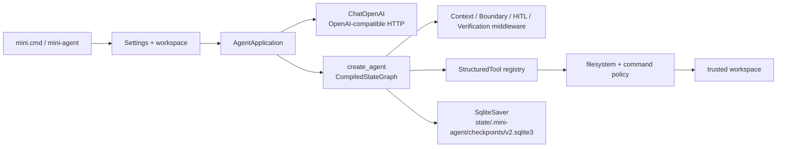

# mini-agent-lab

一个面向受信任本地项目的受控 coding agent。v2 使用 LangChain 的
`create_agent` 组装标准工具循环，使用 LangGraph 保存会话状态、处理中断和
恢复；文件安全、命令白名单、审批策略和任务验收仍由本项目负责。

当前公开入口是同步的 Windows/package CLI。传输测试使用本地、脚本化的
OpenAI-compatible HTTP 服务验证了模型请求、工具调用、文件修改、错误返回和
SQLite 恢复。真实模型也已完成一次文件与代码维护验收：5 次模型调用、9 次工具
调用，指定测试与独立验收通过；完整证据和复现步骤见 [迁移与验证记录](docs/migration.md)。

## 安装与配置

需要 Python 3.11 或更高版本。Windows 从源码目录运行：

```powershell
py -3.11 -m venv .venv
.\.venv\Scripts\python.exe -m pip install -c requirements.lock -e ".[dev]"
.\mini.cmd config
```

`config` 交互式写入 `OPENAI_BASE_URL`、`OPENAI_MODEL` 和
`OPENAI_API_KEY`。配置文件位于状态目录的 `.env`，不会写入模型请求参数，也不
应提交到 Git。状态目录由 `MINI_AGENT_STATE_DIR` 决定；源码 checkout 默认使用
项目目录以保持现有 `.env` 约定，安装后的默认位置是用户目录下的
`.mini-agent`。需要切换位置时，在运行命令前设置变量：

```powershell
$env:MINI_AGENT_STATE_DIR = "$HOME\.mini-agent"
.\mini.cmd config
```

也可以直接使用安装后的入口：

```powershell
.\.venv\Scripts\mini-agent.exe config
```

Linux/macOS 使用等价的 `python3.11 -m venv .venv`、`.venv/bin/pip` 和
`.venv/bin/mini-agent`。模型配置仍使用同名环境变量；`OPENAI_BASE_URL` 必须
指向兼容 Chat Completions 的服务地址。

## 常用命令

选择工作目录后启动交互式会话：

```powershell
.\mini.cmd start --workspace C:\path\to\trusted-project
```

一次性任务以一行 JSON 输出结果，适合脚本和 Web UI：

```powershell
.\mini.cmd task `
  --task "修复计算逻辑并运行测试" `
  --workspace C:\path\to\trusted-project
```

JSON 结果包含 `session_id`、`task_id`、`status`、`answer`、`interrupts`、
`pending_nodes`、`trace` 和 `error`。副作用工具处于 `ASK` 审批模式时，命令会
返回 `status: "interrupted"` 和完整的审批动作；批准或拒绝使用同一个会话：

```powershell
.\mini.cmd task --resume SESSION_ID --approve --workspace C:\path\to\trusted-project
.\mini.cmd task --resume SESSION_ID --reject  --workspace C:\path\to\trusted-project
```

`--approve` 和 `--reject` 只处理当前 checkpoint 中的待审批动作，恢复时仍会
重新校验工作区和工具前置条件。`ALLOW` 适用于已信任的临时项目，`DENY` 会拒绝
副作用工具；默认 `ASK` 不会静默放宽审批。

Coding Contract 通过 JSON 文件限定允许修改的相对路径和验收测试：

```json
{
  "task_id": "fix-calculator",
  "instruction": "修复 calculator.py 的加法错误",
  "allowed_paths": ["calculator.py"],
  "test_command": {"command": "python", "args": ["-m", "pytest", "-q"], "cwd": "."},
  "require_test_pass": true
}
```

运行 contract：

```powershell
.\mini.cmd task --contract C:\path\to\contract.json --workspace C:\path\to\trusted-project
```

`doctor --workspace PATH` 只检查本地路径和配置存在性，不访问模型；`sessions`
读取 SQLite checkpoint，`sessions --legacy` 只列出历史 JSON 文件；`version` 返回
包版本。Windows 下 `agent.cmd` 仍是调用 `mini.cmd start` 的兼容包装器。

## v2 架构



应用装配发生在 `mini_agent.runtime.AgentApplication`：它读取
`mini_agent.settings.Settings`，调用 `mini_agent.models.create_model`，通过
`mini_agent.tools.registry.build_tools` 得到唯一的模型可见工具集合，再把模型、
工具、middleware 和 `SqliteSaver` 交给 `langchain.agents.create_agent`。完整模块
职责、状态字段和扩展边界见 [`docs/architecture.md`](docs/architecture.md)。

工具适配层使用 LangChain `StructuredTool` 和 Pydantic 参数模型。工作区以绑定
参数注入 handler，不出现在模型 schema 中；工具返回
`content_and_artifact`，其中 `ToolResult` 的状态、错误码和元数据留在
`ToolMessage.artifact`。`risk`、`mutation`、`workspace_arguments` 和
`mutation_paths` 由 `BoundaryMiddleware` 用于审批、contract 路径检查和前置条件
校验。

## 开发任务能力（下一轮迭代）

原有的文件读取、全文搜索、补丁修改和测试执行之外，`run_command` 现在支持：
`python -m pytest/unittest/ruff/mypy/compileall/build`、工作区内 `python path/to/script.py`
以及只读的 `git status/diff/log/ls-files`。

这让 Coding Agent 能实际运行仓库内的 Python 脚本、静态检查和构建步骤，而不是只会改代码和跑单元测试。
命令仍使用现有的无 shell 进程执行器、工作区限定、超时和输出上限；
默认 `ASK` 审批对执行工具仍然生效。这不是操作系统隔离：**仅用于受信任项目**。
`pip install` 不在默认命令列表中，依赖安装应在开发者管理的虚拟环境完成。

项目导航工具同样使用已有的工作区保护：`find_files(pattern, path)` 递归列出匹配路径，
`inspect_python_symbols(path, query)` 通过 Python AST 定位类、函数、方法和行号，
不执行被分析代码。两者都限制扫描范围和结果长度，避免把整个项目直接塞进模型上下文。

## 状态、恢复与副作用边界

同一 `thread_id` 是 LangGraph checkpoint 的恢复主键。当前状态目录结构为：

```text
{state_dir}/.env
{state_dir}/.mini-agent/checkpoints/v2.sqlite3
{state_dir}/.mini-agent/journals/{task_id}.json
{state_dir}/trace.jsonl              # 仅在设置 MINI_AGENT_TRACE_JSONL 时
```

工作区快照会跳过 `.git`、`.venv`、`venv`、`node_modules` 和 `.mini-agent` 等生成
目录，避免 SQLite 和 journal 污染任务验收。状态目录应放在工作区之外，并设置
合适的本机权限；会话消息和 journal 可能包含文件内容与工具参数，不能当作秘密
保险箱。

SQLite saver 保存图节点状态和写入记录，因而可以在 HTTP 错误、进程退出或 HITL
中断后按同一 `thread_id` 继续。它只证明图状态已写入；如果外部副作用已经发出
但还没有收到回执，checkpoint 不能证明该副作用没有发生，也不能提供 exactly-once
语义。写工具因此依赖原子文件写入、前置条件、journal 和恢复时复核；对外部系统
的适配仍需要幂等键、结果查询或人工确认。

## 安全边界与限制

- 文件工具只允许规范化后的工作区路径，并限制敏感路径、链接和文件大小。
- `run_command` 使用 `shell=False`，允许工作区内的 `python script.py`、
  `python -m pytest/unittest/ruff/mypy/compileall/build` 以及只读的
  `git status/diff/log/ls-files`，同时限制 cwd、超时、输出和子进程环境；
  不允许 `python -c`、`pip install` 或任意 shell 命令。
- 工作区和命令策略不是 OS sandbox。受信测试代码仍可能访问当前用户可访问的
  文件、网络和解释器能力；执行不可信项目应另外使用无密钥容器或虚拟机。
- Trace 默认只保留当前进程内存事件；设置 `MINI_AGENT_TRACE_JSONL` 才会追加
  脱敏后的事件。Trace 不是完整会话记录。
- 当前没有公开的异步/`ainvoke` 或 streaming API。`AgentApplication` 是同步
  API seam；需要实时 UI 时先消费 JSON 结果和 `interrupts`，不要猜测内部 graph
  节点。
- memory、web browsing、multi-agent、长期 Store 和通用 MCP/RAG 连接尚未并入
  v2。框架不会把 checkpoint 当长期知识库。

## 验证

开发依赖安装后运行：

```powershell
.\.venv\Scripts\python.exe -m pytest -q
.\.venv\Scripts\python.exe -m ruff check .
.\.venv\Scripts\python.exe -m mypy
# 推荐统一入口：在不含真实配置的临时副本中运行全部检查。
.\.venv\Scripts\python.exe scripts/check.py
```

`tests/test_transport.py` 启动临时本地 HTTP provider，覆盖多步
list/search/read/apply/read/final、HTTP 错误后的可恢复 checkpoint，以及
`mini.cmd task` JSON 子进程路径；测试不会读取真实 `.env` 或访问外部模型。

另有一次实际模型验收作为同步链路的烟雾证据：运行 17.13 秒，5 次模型调用、
9 次工具调用、14,208 total tokens，修改了 `calculator.py` 和 `notes.txt`，指定
测试通过，独立 verifier 返回 `accepted`。这是一条受控验收记录，不代表模型质量
基准或长期 provider 稳定性。

## 依赖与研究基线

当前工程约束 LangChain 1.x 兼容组：`langchain>=1.4.4,<1.5`、
`langchain-core>=1.6.9,<2`（由 LangChain 约束）、`langchain-openai>=1.7.0,<1.8`、
`langgraph>=1.2.14,<1.3`、`langgraph-checkpoint-sqlite>=3.1.1,<3.2`。
源码提交、稳定 API 约束、HITL 和 SqliteSaver 参考见
[`docs/framework-references.md`](docs/framework-references.md)。升级应重新验证
整组依赖，不要只升级 `langchain`。

## 路线图

按优先级排列：

1. 增加 MCP tool adapter 和独立的 RAG-chain adapter，把外部工具/检索接到现有
   `StructuredTool` 与 policy 边界；RAG 数据源和 checkpoint 不合并，检索结果也
   不直接写入任务状态 schema。
2. 当规划、测试、验收、恢复需要显式分支时，再增加以 `create_agent` 为节点或子图
   的 `StateGraph` workflow；基础工具循环继续由 `create_agent` 托管。
3. 在同步 API 的状态和错误语义稳定后，再公开 async/streaming seam，并为
   `AsyncSqliteSaver` 单独验证生命周期。
4. memory、web、multi-agent 和跨会话长期 Store 延后到明确的权限、保留周期和
   数据边界方案确定后；它们不会通过扩大 checkpoint schema 临时加入。

历史评测报告仍保留在 `benchmark/reports/` 供回归参考，但它们是旧运行时的脚本
化证据，不能替代当前 LangChain v2 的真实 provider 评测。

## License

见 [`LICENSE`](LICENSE)。
