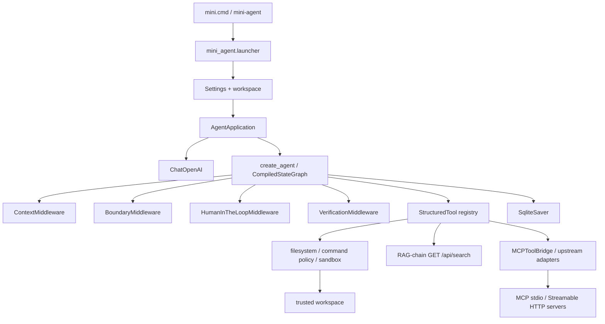

# v2 架构说明

本文描述当前代码，而不是未来规划。v2 把通用的模型与工具循环交给
LangChain/LangGraph，把工作区安全、命令策略、审批和 Coding Contract 验收保留
在 mini-agent 的业务层。入口目前只有同步 API；`async`、streaming、memory、web
和 multi-agent 没有作为公开能力实现。

## 运行时装配

`mini_agent.runtime.AgentApplication` 是应用装配边界。进入上下文时依次完成：

1. `mini_agent.persistence.checkpoint_store` 打开
   `SqliteSaver`，数据库位于 `{state_dir}/.mini-agent/checkpoints/v2.sqlite3`。
2. `mini_agent.tools.registry.build_tools(workspace)` 创建绑定到当前工作区的
   LangChain `StructuredTool` 列表。`AgentApplication` 按配置加入 RAG、MCP 和
   `extra_tools`，在编译 graph 前统一拒绝重复工具名。
3. 根据 `TOOL_APPROVAL_MODE` 加入 `HumanInTheLoopMiddleware`（`ASK` 时）、
   `BoundaryMiddleware`、`ContextMiddleware`、`VerificationMiddleware` 和
   `ModelCallLimitMiddleware`。
4. `mini_agent.models.create_model` 创建 `ChatOpenAI`，把
   `OPENAI_BASE_URL`、`OPENAI_API_KEY`、`OPENAI_MODEL` 和请求超时注入模型。
5. 通过 `langchain.agents.create_agent` 编译 graph，并把模型、工具、业务状态
   schema、系统提示、middleware 和 checkpointer 接到一起。



`create_agent` 负责基础的 model → tool → model 循环，不再由项目维护第二套
工具调用 ID 配对或手写 while loop。业务 middleware 只处理横切约束：上下文
投影、权限与前置条件、审批、验收和资源额度。

## 状态与一次运行

`mini_agent.state.TaskState` 扩展 LangChain `AgentState`，保留框架的
`messages` reducer，并增加这些业务事实：

| 字段 | 用途 |
| --- | --- |
| `workspace` | 会话绑定的规范化工作区；恢复时必须相同 |
| `task_id` | 一次任务和 journal 的身份 |
| `contract` | 可选 Coding Contract 的序列化内容 |
| `initial_snapshot` | 任务开始时的工作区摘要 |
| `task_start` | 本任务在消息状态中的起点 |
| `preconditions` | 模型提出写操作后记录的文件前置条件 |
| `verification` | 最终验收结果 |
| `status` | `running`、`completed` 或 `incomplete` 等任务状态 |

新任务调用 `app.run(task, thread_id=...)` 时会拒绝空任务和仍有 pending step 的
旧线程，然后写入用户消息、工作区绑定、任务 ID 和初始快照。LangGraph 在节点
执行期间保存消息、工具调用、工具结果和这些业务字段。调用方必须为每条会话使用
合法且稳定的 `thread_id`；当前实现限制为 1 到 100 个字母、数字、下划线或连字符。

恢复调用 `app.run(None, thread_id=...)`：

- 没有 checkpoint 会返回错误，不会把旧 JSON 会话误当作可执行状态；
- 有待审批中断且没有 decisions 时，只返回当前待审批信息；
- 有待审批决策时，把 `Command(resume={"decisions": decisions})` 交给同一个
  graph 和同一个 thread；
- 没有 pending node 时只读取最终状态，不重复调用模型。

HTTP 错误、模型限额或进程中断会返回 `failed`/`cancelled`，同时保留最近一次
已提交的 graph checkpoint，因而可以用同一个 `thread_id` 重试。checkpoint 中的
状态是最后一次已提交节点的事实；一次模型请求失败后，业务 `status` 可能仍是
`running`，调用方应优先展示本次返回的 `error`，恢复成功后再显示最终状态。

## 工具注入与结构化结果

`build_tools` 构造内建工具；应用汇总后的工具列表是模型可见能力的唯一来源。
内建/RAG 工具由 Pydantic 输入模型描述，MCP 保留上游 JSON Schema。
工作区通过闭包/partial 注入，模型不会获得 `workspace` 参数。当前工具集合：

| 工具 | 风险 | 变更 | 作用 |
| --- | --- | --- | --- |
| `list_files` | read | 否 | 列出工作区内一层目录 |
| `read_file` | read | 否 | 读取有界 UTF-8 文本 |
| `search_text` | read | 否 | 递归搜索固定字符串 |
| `find_files` | read | 否 | 按模式递归定位文件 |
| `inspect_python_symbols` | read | 否 | AST 定位函数、类、方法和行号 |
| `write_file` | write | 是 | 原子写入完整文件 |
| `apply_patch` | write | 是 | 唯一精确替换文本 |
| `rename_file` | write | 是 | 不覆盖目标的重命名 |
| `run_command` | execute | 否* | 运行受控的无 shell 命令 |
| `inspect_project` | read | 否 | 读取项目白名单源码 |
| `inspect_capabilities` | read | 否 | 返回工具和 runtime 能力元数据 |
| `search_knowledge` | read | 否 | 可选外部 RAG 搜索，保留出处与 chunk/rank |
| `mcp_<server>_<tool>` | 配置决定 | 配置决定 | 可选 MCP 工具，显式允许列表 |

`*` `run_command` 的 registry 元数据不是文件 mutation；它仍可能通过受控测试产
生副作用，风险级别为 `execute`，并受命令白名单、cwd、输出和超时限制。Coding
Contract 的最终工作区快照会检查命令造成的额外文件变化。

工具 handler 的结果经过 `_tool_artifact` 适配为
`(content, artifact)`。`ToolResult` 的 `status`、`code` 和 `metadata` 进入
`ToolMessage.artifact`，文本进入模型上下文。这样模型仍能阅读简洁结果，UI、
验收和 Trace 可以依据结构化状态判断成功、拒绝、命令失败或超时，而不必解析
自然语言前缀。

`BoundaryMiddleware` 在工具执行前：

- 验证会话工作区与当前 Settings 一致；
- 在 `DENY` 模式拒绝非 read 工具；
- 对 Coding Contract 的 mutation path 做相对路径检查；
- 使用模型提出 tool call 时的前置条件阻止并发/同期改动覆盖；
- 为 mutation 建立 task journal，并把工具状态和耗时发给 `Events`。

文件路径安全和命令策略仍位于 `mini_agent.sandbox`、
`mini_agent.tools.filesystem` 和 `mini_agent.tools.command`，不由 LangChain
middleware 代替。应用层策略是工作区边界，不是操作系统隔离。

## 基于 LangGraph Checkpoint 的任务计划

`mini_agent.planning` 在原 `create_agent` 中注册
`set_task_plan`、`update_task_step`、`get_task_plan`。
LangChain `ToolRuntime` 隐式注入当前 `TaskState` 和 tool_call_id；
计划修改返回 `Command(update={plan, messages})`，带关联
`ToolMessage`，由 LangGraph checkpoint 保存。没有额外的规划状态数据库。
切换新任务时重置 `plan`；新进程恢复旧 thread 时仍能读取计划。

状态机限定计划步骤数量、状态转换及前置顺序。计划重排必须说明原因，
每次更新只写当前任务状态，不进行工作区文件操作，因此工具策略标记
`risk=read`、`mutation=False`。它们仍通过现有 BoundaryMiddleware，
批次中拒绝两个及以上计划写入，避免同一 graph step 并发写计划状态。
对外 `result.plan` 和 `session_info.plan` 仅输出脱敏摘要，
Plan 不是 Coding Contract 的测试结果或替代验收证明。

## 上下文、资源额度与验收

`ContextMiddleware` 只改变送给模型的消息视图：工具文本超过上限时截断并清除
其 artifact，较早历史按预算裁剪；checkpoint 仍保留完整消息和 artifact。当前
同步入口把 `RunBudget` 放入 context variable，middleware 和进程 runner 共同检查：

- 单任务时限、模型请求数和工具调用数；
- 单批工具数量；
- 上下文字符、单次输出 token 和累计 token；
- 缺失 provider usage 时的 `STOP` 或 `ESTIMATE` 策略。

模型返回没有完整 usage 时，默认保守停止后续模型调用；UTF-8 字节或字符估算是
资源保护手段，不是 provider 计费 token 的精确值。

没有 Coding Contract 时，`VerificationMiddleware.after_agent` 只要求最终 AI
回答存在且没有未解决工具错误。带 Contract 时，middleware 会把允许路径、指定
测试和测试新鲜度注入模型指导；最终回答过早到达时会追加验收反馈，让 graph 继续
处理。`verify_contract` 再独立检查工作区快照、允许变更、测试退出码/摘要和测试
是否发生在最后一次 mutation 之后。

## HITL 响应与 UI seam

默认 `TOOL_APPROVAL_MODE=ASK`。runtime 为 risk 不是 `read` 的工具装配
`HumanInTheLoopMiddleware`，当前允许的决策是 `approve` 和 `reject`。应用通过
`get_state(config)` 读取中断，把每个 action 的名称、参数、描述和 review config
放在 JSON 结果的 `interrupts` 中：

```json
{
  "session_id": "abc123",
  "status": "interrupted",
  "interrupts": [
    {
      "action_requests": [
        {"name": "apply_patch", "args": {"path": "app.py"}, "description": "..."}
      ],
      "review_configs": [
        {"action_name": "apply_patch", "allowed_decisions": ["approve", "reject"]}
      ]
    }
  ],
  "pending_nodes": ["HumanInTheLoopMiddleware.after_model"]
}
```

CLI/Web UI 只需要把当前动作按顺序映射为
`{"type": "approve"}` 或 `{"type": "reject"}`，再用相同 `thread_id` 调用
resume。不要另存一份待执行 tool call，也不要在 UI 中重新调用 handler。未来
如果暴露 LangGraph `GraphOutput` v2，应固定一种输出版本；当前公开
`AgentApplication` 已经把中断折叠为上面的稳定 JSON seam。

## 持久化与副作用语义

`mini_agent.persistence.checkpoint_store` 使用同步
`langgraph.checkpoint.sqlite.SqliteSaver`，连接由 `AgentApplication` context
manager 打开和关闭，并启用 WAL。私有状态路径是：

```text
{state_dir}/.env
{state_dir}/.mini-agent/checkpoints/v2.sqlite3
{state_dir}/.mini-agent/checkpoints/v2.sqlite3-wal
{state_dir}/.mini-agent/checkpoints/v2.sqlite3-shm
{state_dir}/.mini-agent/journals/{task_id}.json
```

SQLite saver 保存 graph state/checkpoint writes，不保存一个外部系统的事务。若
写文件、命令或未来的 MCP 调用已经发出但应用在收到响应前退出，恢复无法推断该
副作用是否已发生，因此不能承诺 exactly-once。当前文件 mutation 通过原子替换、
前置条件和 journal 降低风险；外部适配应自行提供幂等键、状态查询或人工确认。

工作区快照跳过 `.git`、`.venv`、`venv`、`node_modules` 和 `.mini-agent`。这会
避免状态文件污染 Coding Contract 的 changed-files 结果，但不意味着状态内容不
敏感。会话消息可能含文件正文、路径和工具参数，状态目录必须是本机私有位置。

## Git 本地交付工具

`mini_agent.git_workflow.build_git_tools(workspace)` 增加只读
`git_worktree_review` 与需审批的 `git_commit_files`。它只对与
workspace 完全同根的本地 Git 仓库工作，使用原有 `run_process`
进程树/环境/输出保护。后者拒绝已有暂存区内容，通过明确路径进行
Git add 与本地 commit，禁止自动 push，且禁用 Hooks/GPG。
Coding Contract 任务在提交前先通过 `verification_facts` 与
`evaluate_finish_request` 校验指定测试时效与实际更改路径。
Git 索引和 refs 不在文件 journal 范围内，也无远程 exactly-once 保证。
需要 push/PR 的工作流应通过另外批准的 GitHub MCP 接入。

## 自动恢复回合与证据边界

`mini_agent.recovery.decide_recovery` 只读当前 LangGraph
checkpoint 中的 `status`、`plan`、失败 ToolMessage 与验收状态，
将恢复动作分类成 `command_failure`、`edit_failure`、
`tool_failure`、`plan_progress`、`verification`。
`AgentApplication.run(..., auto_recover=True)` 仅在上一个图调用已完成且
返回 actionable `incomplete` 时，往**同一 checkpoint**追加一条
限定范围的恢复指导消息并调用同一个 compiled `create_agent`。
这不是新的自研执行引擎，也不会旁路 Tool Boundary/Verification/HITL。

每个自动恢复调用只允许 1–3 次额外模型回合，单次运行的
`RunBudget` 跨回合继续记账，限制总时间、模型请求、工具和 token。
`work_signature` 根据计划进度、成功文件写入/测试工具事件判断停滞，
只允许有实际进展的恢复继续迭代；明确 blocked、权限拒绝、审批中断则停止。
外部 MCP 副作用无法保证 exactly-once，自动恢复不会自动重放它。
CLI 默认不开启以保持以前的脚本行为，可使用 `--auto-recover` 显式开启。

## 可选 GitHub CLI 远程交付

`mini_agent.github_delivery.build_github_tools(settings)` 在设置 `MINI_AGENT_GITHUB_REPO` 和 `MINI_AGENT_GITHUB_TOKEN` 后才注册远程工具。流程为：

`git_commit_files` → `github_push_branch` → `github_create_draft_pr` → `github_pr_status`。

写工具以独立、可审批的调用通过现有 HumanInTheLoopMiddleware；origin URL、工作区、分支、测试和最新 commit 均经过校验。不推送默认/发布分支、不强推、不自动合并。凭据只通过 `run_process(extra_env={"GH_TOKEN": token})` 注入 Git/gh 子进程，不进入模型参数、工具结果和审计事件。固定 Git Credential Helper 用于 GitHub HTTPS 认证，但它属于 Git 内部额外子进程，不是任意 Shell 沙盒。外部网络副作用不具有 Checkpoint 回滚/严格 exactly-once 语义。

CI 仅验证真实本地 Git 预检、Graph/HITL 行为与模拟 gh 网络响应，真实 GitHub 远程写入需要受控测试仓库的另外验收。

## 项目级 Python / Node 工具

mini_agent.dev_environment.build_dev_environment_tools 使用标准 LangChain @tool 注册
inspect_dev_environment（只读）、prepare_dev_environment（安装和创建项目专用运行环境）、
run_dev_task（对 Python/Node 执行受支持的运行、测试、lint、typecheck、build、已声明脚本）。
该模块在现有 AgentApplication.create_agent 中直接注册，无第二套 Agent 执行循环。
工具 path 绑定到原受信 workspace 的子目录，沿用 run_process 的进程树清理、超时、输出限制和预算。
Python 使用子项目 .venv；Node 使用 package.json/scripts 和 npm/pnpm 锁文件。
执行工具以 content_and_artifact 返回真实成功/失败状态，供原有失败恢复机制判断。
只有 Python 子项目真实隔离运行通过 CI，Node 进程测试不接公网而模拟 npm/pnpm。
## 同步 API 与扩展点

最小程序化调用：

```python
from pathlib import Path

from mini_agent.runtime import AgentApplication
from mini_agent.settings import Settings

settings = Settings.load(Path("trusted-project"), Path(".mini-agent"))
with AgentApplication(settings) as app:
    result = app.run("读取 README 并总结", thread_id="demo-session")
```

测试或集成层可以注入兼容 LangChain chat model 的 `model=`，也可以通过
`extra_tools=` 加入额外工具；工具名必须唯一，额外工具仍应提供 `risk`、
`mutation` 等 metadata 并接受 Boundary policy 的约束。新的工作区工具应优先
进入 `build_tools` 和统一 Pydantic schema，而不是在 CLI 里旁路调用 handler。

当前没有 `AgentApplication.ainvoke`、streaming UI 或 AsyncSqliteSaver seam。异步
和流式能力要在同步结果、错误、HITL 和 checkpoint 语义稳定后另行设计。

一次实际模型验收已验证这条同步装配链路：17.13 秒内完成 5 次模型调用和 9 次
工具调用，账面 total tokens 为 14,208；任务修改 `calculator.py` 与 `notes.txt`，
指定测试通过，独立 verifier 返回 `accepted`。该记录证明一次端到端运行可达，
不构成 provider 或模型质量基准。

## 规划边界

后续扩展按以下顺序评估：

1. **MCP tool adapter 与独立 RAG-chain adapter**：把外部工具和检索结果接入
   `StructuredTool`/policy 层；RAG 数据源保持独立，不把 RAG 和记忆或 checkpoint
   schema 合并。
2. **规划型 StateGraph**：只有需要规划 → 执行 → 测试 → 验收的条件分支、Recovery
   跳转、并行子图或外部事件等待时再引入；`create_agent` 仍作为节点/子图负责
   基础模型工具循环。
3. **Async/Streaming 公共接口**：为异步模型和 `AsyncSqliteSaver` 单独验证
   生命周期、取消和 UI 事件契约后再发布。
4. **Memory、web、multi-agent 和长期 Store**：暂缓，先明确权限、数据保留、
   跨会话隔离和审计边界，不通过扩大短期 checkpoint 解决。

上游 API、版本基线和实际读取过的源码链接见
[`docs/framework-references.md`](framework-references.md)。


## 可选外部 Tool 插件层

- mini_agent.rag_chain.build_rag_tool：绑定配置的 RAG_CHAIN_URL，向已有
  rag-chain GET /api/search 只读检索，保留原文和来源，不启动新 RAG Runtime。
- mini_agent.mcp_tools.MCPToolBridge：可选安装 langchain-mcp-adapters；
  由 MultiServerMCPClient 转换远端 MCP tools，在独立事件循环中执行远端异步
  ainvoke，并通过同步 StructuredTool 适配到当前 create_agent。
- mini_agent.runtime.AgentApplication.__enter__：仅在用户提供配置时
  增加这些工具；仍然只创建一个 Agent/CompiledStateGraph，复用 Boundary/HITL。
- 用户显式列出的 MCP 工具才能暴露给模型。非只读外部工具默认执行审批；
  无本地 mutation_paths 的远端写工具无法通过 Coding Contract 限制。
- 远端 MCP Server 和 RAG 索引都不与 SQLite checkpoint 合并。

MCP 使用上游默认的每次调用独立会话：发现和调用分别建立、关闭连接。
`MCPToolBridge` 持有的是后台事件循环，不承诺远端会话中的状态跨工具调用保留。
超时会取消本次调用；关闭会取消并等待剩余任务、异步生成器和执行器清理，
再关闭事件循环。远端副作用超时不会自动重放。

RAG 来源的 rank、score、title、file_path、heading、source 和 chunk_index
同时保存在有界展示文本和 `ToolMessage.artifact.metadata.sources` 中；
模型上下文裁剪不修改持久化的原始工具结果。MCP 结构化返回值位于
`artifact.metadata.remote_artifact`，超过上限时明确标记 artifact_truncated。
脱敏在字段/片段截断之前完成，避免留下已知凭据的部分前缀。

独立服务、真实模型任务、恢复和工程验证记录见
[本轮验收报告](evaluation/MCP_RAG_QA_20261012.md)。
